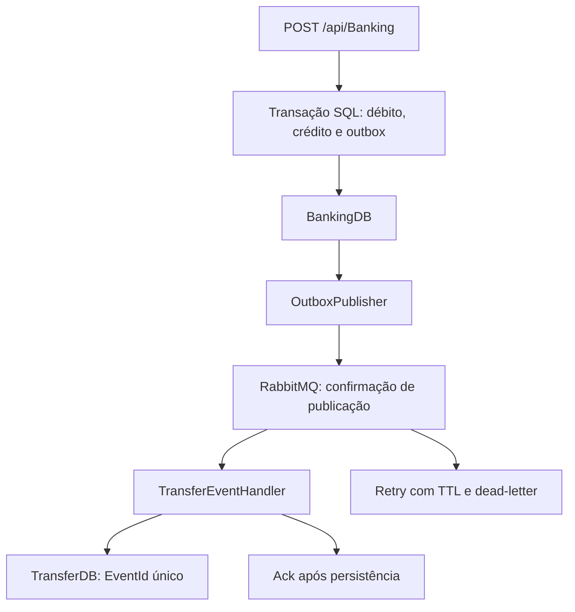

# MicroRabbit — transferências, outbox e mensageria confiável

Laboratório de backend em **C# / .NET 10**, com duas APIs ASP.NET Core, SQL Server, EF Core e RabbitMQ. O Banking grava transferências entre contas; o serviço Transfer mantém um log independente, atualizado por eventos. A interface MVC permanece disponível como cliente opcional.

Este é um projeto de portfólio e estudo. O ambiente fornecido usa dados fictícios e serviços locais; não há autenticação, integração bancária real ou implantação cloud comprovada.

## Melhorias implementadas

| Item do roteiro anterior | Implementação |
| --- | --- |
| Consumidor e operações assíncronas | Conexão/canais mantidos até shutdown, resolução de dependências por escopo, comando aguardado, falhas registradas e encerramento do host se o canal não puder continuar. |
| Invariantes e concorrência | Contas distintas e existentes, valor positivo com duas casas decimais, saldo suficiente, limite do saldo de destino e bloqueios SQL para débitos concorrentes. |
| Consistência e entrega | Débito, crédito e outbox na mesma transação; publicação com confirmação; filas quorum duráveis, mensagens persistentes, ack após persistência, retries com atraso e dead-letter. |
| Atualização e configuração | Projetos principais em .NET 10, EF Core 10.0.14, Swashbuckle 10.3.1, Newtonsoft.Json 13.0.4; configurações externas e Compose com migrations. |
| Testes e CI | Testes de unidade, testes SQL/RabbitMQ, migrations e teste do fluxo HTTP em containers no [workflow](.github/workflows/ci.yml). |

MediatR 10.0.1 foi preservado para manter o contrato de comandos. RabbitMQ.Client foi atualizado para 6.8.1, mantendo sua API de canais; uma migração para a API assíncrona 7.x é uma evolução separada. Os exemplos históricos de `Resources/FirstLesson` não integram a solução modernizada.

## Arquitetura e garantias



- O valor sai da origem e entra no destino **dentro da mesma BankingDB**. O serviço Transfer é um consumidor de auditoria, não o responsável por creditar outra instituição.
- A resposta HTTP **202** indica transferência gravada e evento pendente/em processamento; não confirma que o log já chegou ao consumidor.
- O publicador só marca o evento como publicado após confirmação do broker. Se cair entre publicação e marcação, republica; o índice único de `EventId` impede logs duplicados.
- O consumidor usa ack manual após salvar. Falhas vão para uma fila de retry com TTL; após `MaxRetries` novas tentativas, seguem para `.dead`. Filas quorum usam dead-letter com estratégia `at-least-once` e overflow `reject-publish`.
- A semântica é **pelo menos uma vez**, com deduplicação do efeito no log. Não se promete processamento exatamente uma vez ou disponibilidade com um único nó.

### Organização

A [solução](Main%20Solution/MicroServicesRabbitMQ/MicroServicesRabbitMQ.sln) contém os projetos:

| Grupo | Responsabilidade |
| --- | --- |
| `MicroRabbit.Banking.Api` e `MicroRabbit.Transfer.Api` | HTTP, Swagger, health checks, configuração e migrations. |
| `*.Application` | Serviços e contratos da aplicação. |
| `*.Domain` | Modelos, regras, comandos, eventos e interfaces. |
| `*.Data` | EF Core, transações, outbox e deduplicação do log. |
| `MicroServicesRabbitMQ.Domain.Core` | Contratos do bus, mensagens e identificador de evento. |
| `MicroServicesRabbitMQ.Infrastructure.Bus` | Publicação confirmada, consumidor, retries e descarte de recursos. |
| `MicroServicesRabbitMQ.Infrastructure.IoC` | Registro de dependências. |
| `MicroRabbit.Presentation.MVC` | Cliente web opcional. |
| `MicroRabbit.Tests` | Testes unitários e integração. |

O contrato `TransferCreatedEvent` ainda fica no domínio Banking e é referenciado por Transfer. Extrair contratos versionados para um projeto independente continua sendo uma melhoria possível.

## Subir o ambiente local

Pré-requisitos: Git, Docker Engine/Desktop e Docker Compose v2. As imagens SQL Server exigem host compatível; reserve memória suficiente para SQL Server e o build do SDK. A reprodução foi preparada para Linux x64 e deve ser validada no seu host.

```bash
git clone https://github.com/fernandojs8/.NET-Core-Microservices-RabbitMQ-MediatR-CleanArchitecture.git
cd .NET-Core-Microservices-RabbitMQ-MediatR-CleanArchitecture
cp .env.example .env
# Escolha senhas locais no .env antes de iniciar.
docker compose up --build -d
```

O Compose espera SQL/RabbitMQ saudáveis, executa migrations em jobs separados e inicia as APIs. O `.env` é ignorado pelo Git; use um gerenciador de segredos numa futura implantação. As senhas do exemplo são exclusivamente locais. As portas são vinculadas a `127.0.0.1`.

| Serviço | Endereço local |
| --- | --- |
| Banking Swagger | http://localhost:5000/swagger/index.html |
| Transfer Swagger | http://localhost:5002/swagger/index.html |
| RabbitMQ Management | http://localhost:15672 — credenciais do `.env`. |
| Liveness | `/health/live` — processo ativo. |
| Readiness | `/health/ready` — SQL acessível; no Transfer, também conexão/canal do consumidor abertos. |

Readiness do Banking não exige o broker: a outbox permite aceitar transferências com publicação temporariamente indisponível. Isso exige monitorar o acúmulo de eventos pendentes.

### Dados e demonstração

As migrations não criam contas reais nem seed automático. Num ambiente **descartável**, com Python 3 e curl instalados, execute:

```bash
bash scripts/smoke.sh
```

O script cria duas contas fictícias, envia uma transferência de 25, espera o log e confere os saldos 75/25. Ele adiciona dados de teste à base local; não o use em um ambiente com dados que precisam ser preservados.

Para inspecionar e parar:

```bash
docker compose logs -f banking transfer
docker compose down
```

Os volumes preservam dados. Excluir volumes é uma decisão separada; o CI remove apenas os seus próprios volumes descartáveis ao terminar.

## Execução pelo SDK

O [global.json](global.json) seleciona .NET 10, com avanço permitido entre feature bands. SQL Server e RabbitMQ precisam estar acessíveis.

```bash
dotnet restore "Main Solution/MicroServicesRabbitMQ/MicroServicesRabbitMQ.sln"
dotnet build "Main Solution/MicroServicesRabbitMQ/MicroServicesRabbitMQ.sln" -c Release
```

Defina variáveis `ConnectionStrings__BankingDbConnection`, `ConnectionStrings__TransferDbConnection` e as opções `RabbitMQ__HostName`, `RabbitMQ__Port`, `RabbitMQ__UserName`, `RabbitMQ__Password`, `RabbitMQ__VirtualHost`, `RabbitMQ__MaxRetries` e `RabbitMQ__RetryDelayMilliseconds` conforme seu ambiente. Não grave credenciais no código.

Execute uma vez por banco, antes de iniciar as APIs:

```bash
dotnet run --project "Main Solution/MicroServicesRabbitMQ/MicroRabbit.Banking.Api" -- --migrate
dotnet run --project "Main Solution/MicroServicesRabbitMQ/MicroRabbit.Transfer.Api" -- --migrate
```

Depois, rode cada API em um terminal com `dotnet run --project` e o mesmo caminho, sem `--migrate`. Os perfis de desenvolvimento usam HTTPS Banking 5001 e Transfer 5003; confira as URLs do terminal. O Compose usa HTTP interno com `DisableHttpsRedirection=true`.

Para o cliente MVC, defina `BankingApi__BaseUrl` (padrão `https://localhost:5001`) e rode `MicroRabbit.Presentation.MVC`. Configure o certificado de desenvolvimento para o uso local de HTTPS.

### Bancos e filas existentes

- As migrations históricas foram preservadas. A nova migration adiciona a outbox e preenche IDs diferentes nos logs antigos antes de criar o índice único. Faça backup e revise o SQL gerado antes de aplicar em bases com dados importantes.
- As novas filas usam o sufixo `.v2` para evitar conflito com as filas antigas não duráveis. Mensagens antigas não são migradas automaticamente; inspecione o backlog e planeje uma conversão explícita de contrato/IDs.
- Não reverta as migrations de forma automática: isso removeria outbox/IDs. Prefira rollback da aplicação compatível com o esquema ou uma correção progressiva testada.

## Testes e validação

```bash
dotnet test "Main Solution/MicroServicesRabbitMQ/MicroRabbit.Tests/MicroRabbit.Tests.csproj" -c Release
```

Sem infraestrutura, os testes de integração aparecem como **skipped**, sem fingir aprovação. Para executá-los, disponibilize SQL Server com permissão de criar/excluir bases de teste e RabbitMQ local:

```bash
export RUN_INTEGRATION_TESTS=true
export TEST_SQL='Server=localhost;User Id=sa;Password=YOUR_LOCAL_TEST_PASSWORD;TrustServerCertificate=True'
dotnet test "Main Solution/MicroServicesRabbitMQ/MicroRabbit.Tests/MicroRabbit.Tests.csproj" -c Release
```

A suíte SQL cria bases com nomes únicos e as remove no fim. A suíte RabbitMQ usa guest/guest local e uma fila exclusiva do tipo de teste; `TEST_RABBIT_VHOST` permite usar um vhost de teste. A autenticação do Compose é própria; para esse teste direto, disponibilize um broker de teste com guest local ou ajuste as opções da suíte.

O [CI](.github/workflows/ci.yml) executa build, testes SQL/RabbitMQ e publica os aplicativos como verificação de empacotamento. Outro job constrói os containers e roda o smoke HTTP, incluindo consumo da outbox. Os resultados TRX ficam como artifacts; veja os [runs reais](https://github.com/fernandojs8/.NET-Core-Microservices-RabbitMQ-MediatR-CleanArchitecture/actions), sem presumir sucesso antes de sua conclusão.

**Validação local da implementação:** build Release e testes unitários devem ser consultados no PR desta mudança. SQL Server, RabbitMQ e Docker não estavam disponíveis no ambiente de desenvolvimento desta revisão; a validação completa depende dos jobs de integração do CI.

## Operação e limites restantes

- API sem autenticação/autorização: o Compose é uma demonstração local. Adicione identidade e permissões antes de qualquer exposição pública.
- Deduplicação é de **eventos**, não de solicitações HTTP. Um novo POST é uma nova transferência; não faça retries cegos de uma requisição cujo resultado ficou desconhecido. Uma chave de idempotência HTTP é uma evolução necessária para clientes de produção.
- Um publicador de outbox por instância pode republicar um evento simultaneamente com outro publicador. O consumidor tolera duplicatas; a outbox ainda não usa leases/claim de lotes, limpeza/arquivamento ou métricas de atraso.
- Falhas transitórias de SQL/deadlocks são propagadas; não há retry automático da operação financeira sem idempotência HTTP.
- SQL Server e RabbitMQ locais possuem um único nó. Volumes, confirmações e quorum queues não substituem backup, replicação e recuperação testada.
- Logs estruturados correlacionam publicação/processamento por `EventId`. Não há pipeline OpenTelemetry, dashboard ou metas de latência medidos.
- Reprocessar a DLQ exige investigação e replay controlado, preservando `EventId`; não descarte mensagens para resolver falhas.

### Evolução cloud

Dockerfile, configuração externa e health checks preparam a aplicação para uma implantação futura. Ainda faltam escolher provedor/recursos, identidade, secret store, TLS de ingresso, infraestrutura como código, deploy/rollback, backups e observabilidade. Não foram provisionados recursos pagos nem publicados números de desempenho ou links de produção sem evidência.

## Licença

[MIT](LICENSE). Os exemplos históricos foram mantidos como material educacional.
