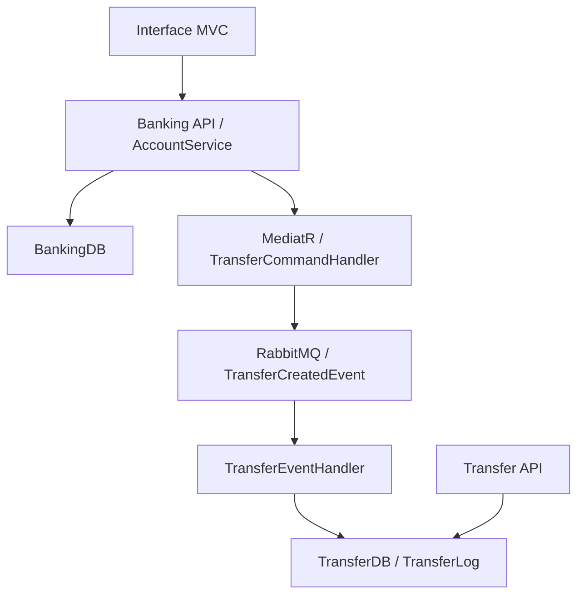

# MicroRabbit — microsserviços .NET, RabbitMQ e MediatR

Laboratório de backend distribuído em **C# / ASP.NET Core**, com APIs de Banking e Transfer, mensageria RabbitMQ, comandos com MediatR e persistência SQL Server por Entity Framework Core. A solução explora separação de responsabilidades em projetos de domínio, aplicação, dados e infraestrutura.

O código é uma demonstração educacional em desenvolvimento. O fluxo de transferência possui limitações de consistência e consumo de mensagens documentadas abaixo; não representa um sistema bancário pronto para produção.

## Estrutura e tecnologias

A [solução principal](Main%20Solution/MicroServicesRabbitMQ/MicroServicesRabbitMQ.sln) fica em `Main Solution/MicroServicesRabbitMQ`.

| Projetos | Responsabilidade |
| --- | --- |
| `MicroRabbit.Banking.Api` / `MicroRabbit.Transfer.Api` | Endpoints HTTP, Swagger e configuração de dependências. |
| `MicroRabbit.Banking.Application` / `MicroRabbit.Transfer.Application` | Serviços de aplicação e contratos. |
| `MicroRabbit.Banking.Domain` / `MicroRabbit.Transfer.Domain` | Modelos, comandos, eventos, handlers e interfaces de repositório. |
| `MicroRabbit.Banking.Data` / `MicroRabbit.Transfer.Data` | DbContexts e repositórios EF Core/SQL Server. |
| `MicroServicesRabbitMQ.Domain.Core` | Abstrações compartilhadas de comandos, eventos e event bus. |
| `MicroServicesRabbitMQ.Infrastructure.Bus` / `.Infrastructure.IoC` | Adaptador RabbitMQ e registro de dependências. |
| `MicroRabbit.Presentation.MVC` | Interface MVC que envia a transferência à API Banking via HttpClient. |
| [Resources/FirstLesson](Resources/FirstLesson) | Exemplos separados de produtor/consumidor RabbitMQ. |

Os projetos principais declaram `netcoreapp3.1`; as APIs referenciam EF Core 5.0.13, MediatR 10.0.1 e Swashbuckle 6.2.3. As versões registradas são históricas; a documentação não implica atualização de framework ou dependências.

## Arquitetura e fluxo implementado



O diagrama descreve as ligações presentes no código; não comprova entrega fim a fim.

1. A interface envia os dados para `POST /api/Banking`.
2. `AccountService` consulta a conta de origem, verifica saldo, altera o saldo em memória, envia `CreateTransferCommand` e atualiza o repositório.
3. O handler publica `TransferCreatedEvent` como JSON na fila de mesmo nome.
4. O handler de Transfer cria um `TransferLog` e chama outro comando, `CreateTransferLogCommand`.
5. `GET /api/Transfer` consulta os registros persistidos. `GET /api/Banking` consulta as contas.

O retorno de sucesso do POST não comprova consumo ou persistência no serviço Transfer. Não foi encontrada implementação de crédito do saldo na conta de destino nesse fluxo.

## Preparação e execução local

Pré-requisitos: Git; SDK/runtime compatíveis com .NET Core 3.1 e os pacotes declarados; SQL Server; RabbitMQ acessível em `localhost` com configuração local compatível com os padrões do cliente; ferramenta `dotnet-ef` compatível com EF Core 5.0.13. Um SDK recente sozinho não garante reprodução deste conjunto legado.

```powershell
git clone https://github.com/fernandojs8/.NET-Core-Microservices-RabbitMQ-MediatR-CleanArchitecture.git
Set-Location ".NET-Core-Microservices-RabbitMQ-MediatR-CleanArchitecture/Main Solution/MicroServicesRabbitMQ"
dotnet restore MicroServicesRabbitMQ.sln
dotnet build MicroServicesRabbitMQ.sln --no-restore
```

Os `appsettings.json` das APIs contêm uma instância SQL Server específica da máquina original. Substitua pelas suas conexões, por exemplo via variáveis no PowerShell, sem versionar credenciais:

```powershell
$env:ConnectionStrings__BankingDbConnection = "Server=localhost;Database=BankingDB;Trusted_Connection=True;"
$env:ConnectionStrings__TransferDbConnection = "Server=localhost;Database=TransferDB;Trusted_Connection=True;"
dotnet ef database update --project MicroRabbit.Banking.Api --startup-project MicroRabbit.Banking.Api --context BankingDbContext
dotnet ef database update --project MicroRabbit.Transfer.Api --startup-project MicroRabbit.Transfer.Api --context TransferDbContext
```

O exemplo usa autenticação integrada no Windows; adapte-a ao seu ambiente. As migrations ficam nas APIs. Prepare contas fictícias na BankingDB antes de testar transferências; não se presume um seed pronto.

Inicie RabbitMQ e abra terminais separados, na pasta da solução, com as variáveis de conexão correspondentes configuradas em cada sessão:

```powershell
# Terminal 1
dotnet run --project MicroRabbit.Transfer.Api
# Terminal 2
dotnet run --project MicroRabbit.Banking.Api
# Terminal 3 — opcional
dotnet run --project MicroRabbit.Presentation.MVC
```

Os perfis de projeto indicam Banking em `https://localhost:5001`, Transfer em `https://localhost:5003` e MVC em `https://localhost:5005`. As APIs expõem `/swagger/index.html`. Configure o certificado HTTPS de desenvolvimento; o cliente MVC usa a URL Banking fixa `https://localhost:5001/api/Banking`. Perfis IIS Express usam outras portas.

## Limitações observadas no código

- **Consumidor:** `StartBasicConsume` cria conexão e canal em blocos `using`; ambos são descartados ao sair do método, comprometendo a continuidade do consumo.
- **Entrega:** filas não duráveis, mensagens sem configuração de persistência e consumo com confirmação automática. Não há garantia demonstrada de processamento confiável, retries, dead-letter ou idempotência.
- **Erros:** o callback do consumidor captura exceções sem registrá-las, dificultando diagnóstico.
- **Consistência:** atualização do saldo e publicação não têm transação distribuída ou outbox. `SendCommand` não é aguardado em partes do fluxo.
- **Comando de log:** o handler chama `CreateTransferLogCommand`, mas o registro de dependências não apresenta um handler correspondente.
- **Regras:** é necessário validar existência das contas, valor positivo, crédito no destino e concorrência antes de considerar uma transferência financeira completa.
- **Configuração:** host RabbitMQ e URL da API MVC estão fixos no código; conexão SQL depende de configuração local.
- A separação em camadas não comprova independência total: Transfer usa o evento definido em Banking e há infraestrutura compartilhada de DI.

## Testes e validação

Não foi identificada suíte automatizada na solução. **Restore, build, migrations e execução não foram realizados nesta revisão**, pois o ambiente não possui `dotnet`. Os comandos acima foram derivados dos projetos e devem ser validados em ambiente compatível, após tratar os bloqueios identificados.

Roteiro de validação proposto: consultar contas fictícias; enviar uma transferência pelo Swagger; observar publicação da mensagem; verificar processamento e persistência do log; comparar saldos; simular mensagem duplicada e indisponibilidade do broker. As limitações atuais podem impedir o fluxo completo; esse roteiro não é um resultado de teste.

## Próximos passos

1. Corrigir o ciclo de vida do consumidor, handlers e operações assíncronas; adicionar logs de falha.
2. Definir as invariantes da transferência e testar saldo, valores inválidos, conta inexistente e concorrência.
3. Implementar entrega confiável com ack manual, idempotência, retries e estratégia de consistência validada.
4. Atualizar framework/pacotes e externalizar configurações; criar ambiente local reproduzível.
5. Adicionar testes unitários, integração SQL/RabbitMQ e CI com resultados reais.

Para demonstrar cloud, adicionar **como trabalho futuro**: infraestrutura como código, pipeline de deploy, health checks, rastreamento correlacionado e uma demonstração com dados fictícios. Publicar recursos realmente utilizados, commit implantado, métricas medidas e procedimento de recuperação; não há evidência de operação cloud/produção apresentada por este laboratório.

## Licença

[MIT](LICENSE).
